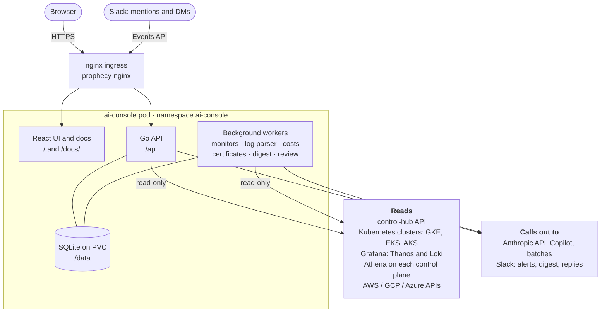
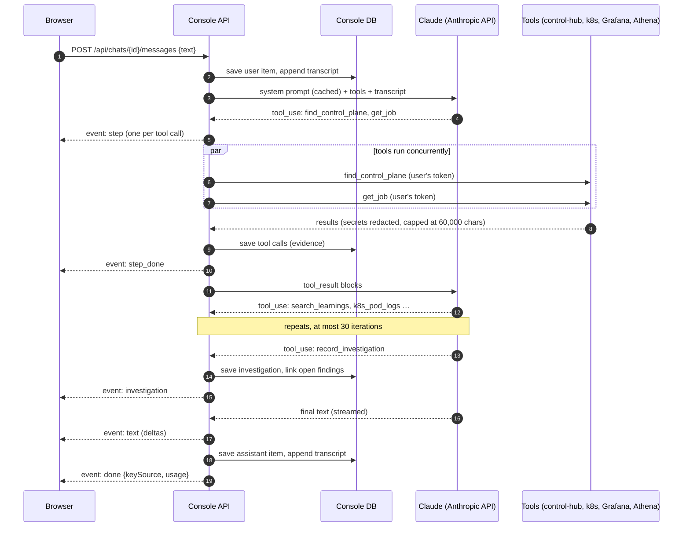
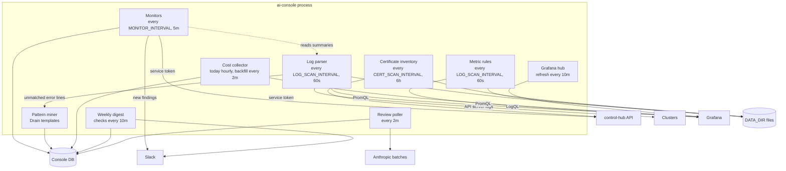

# Architecture

The console is a single Go binary (`cmd/ai-console`) that serves three things from one process:

- the **HTTP API** under `/api` (see the [API reference](../api/index.md));
- the **React UI**, built by Vite and served from `STATIC_DIR` (a single-page app: unknown paths fall back to
  `index.html`);
- this **documentation site** at `/docs/`, from `DOCS_DIR`, for signed-in users;
- the **background workers**: monitors, log parser and pattern miner, metric rules, cost collector, certificate
  inventory, weekly digest and the right-sizing review poller.

It runs as one replica. The monitors and workers run in-process and must not run twice, so the Deployment uses
`replicas: 1` and the `Recreate` strategy.

Its own state lives in a database (SQLite on a persistent volume in the current deployment; Postgres is also
supported, see [Data model](data-model.md)) and in files under `DATA_DIR` on the same volume. Control-hub's data is
never stored: it is always read live through control-hub's API.

## System context

The diagram groups the arrows; the table lists each system, what it is used for and with which credential. The
only writes are the user-approved [actions](actions.md) (a control-hub post-deploy retry, deleting pods), and they are
off while `READ_ONLY=true`.

| External system | Used for | Credential |
|---|---|---|
| control-hub API (`CONTROLHUB_URL`) | Sign-in, control planes, execution planes, infrastructures, jobs; Copilot reads; the one proposed write (retry post-deploy) | The signed-in user's control-hub token. Monitors and the certificate inventory use `CONTROLHUB_SERVICE_TOKEN`, which the client only lets make GET requests. |
| Kubernetes clusters | Cluster explorer, Copilot `k8s_*` tools, log parser, readiness checks | control-hub's own cloud credentials: the pod's Google identity for GKE, a presigned STS token from `AWS_PROD_*` for EKS, the admin kubeconfig fetched with `AZURE_PROD_*` for AKS. Reads use get, list and logs only; the one write is deleting pods for an executed [action](actions.md). |
| Grafana (Thanos and Loki) | Metric rules, charts, Loki-backed log parsing, Copilot `grafana_*` tools, cost collection | A Viewer service-account token per instance (`GRAFANA_<NAME>_TOKEN`, or added in Settings). |
| Athena on each control plane | Copilot `athena_read`, readiness check | `ATHENA_AUTH_TOKEN`. GETs only, to an allow-list of read views. |
| Anthropic API | Copilot chats, key validation, log rule drafts, right-sizing batch review | The user's personal Claude key, or the shared `ANTHROPIC_API_KEY`. |
| Slack (webhook) | New findings and the weekly digest | `SLACK_WEBHOOK_URL` (muted by `SLACK_MUTE=true`). |
| Slack (app) | The [Copilot in Slack](../user-guide/slack.md): mentions and DMs arrive at `POST /api/slack/events`; replies go out through `chat.postMessage` / `chat.update`, and the asker is looked up with `users.info` | `SLACK_BOT_TOKEN`, `SLACK_SIGNING_SECRET`. |
| AWS / GCP / Azure APIs | ACM and Certificate Manager certificates, node list prices | `AWS_PROD_*`, the pod's Google identity, Azure's public Retail Prices API. |
| The cluster the console runs in | control-hub's own pod logs (`search_controlhub_logs`), wildcard TLS secrets | The pod's Kubernetes service account. |

## A Copilot investigation

The Copilot is a tool-use loop over Claude. Each turn streams to the browser over server-sent events. Tools run with
the signed-in user's control-hub token, so the Copilot can only read what that user can read.

See [The Copilot agent loop](copilot-agent.md) for the details: prompt caching, the append-only transcript, tool
output limits and how evaluation replay works.

## Background workers

| Worker | Interval | Reads | Writes |
|---|---|---|---|
| Monitors (`internal/monitor`) | `MONITOR_INTERVAL` (5m) | control-hub with the service token, served certificates, the log parser's summaries | `Finding`, `KV` rows; Slack |
| Log parser (`internal/parser`) | `LOG_SCAN_INTERVAL` (60s) | New log lines per container from each cluster's API server, or from Loki for clusters Grafana covers | `DATA_DIR/hits/<cluster>/<day>.jsonl`, `DATA_DIR/state/<cluster>.json`, `LogRuleHit` rows |
| Pattern miner (`internal/patterns`) | With the log parser; a capped Loki error sample every 30 min | Error-level lines no rule matched | `LogPattern` rows |
| Metric rules (`internal/metricrules`) | `LOG_SCAN_INTERVAL` (60s) | One PromQL query per rule per Grafana instance | `DATA_DIR/metrics/state.json`, `DATA_DIR/metrics/events/<day>.jsonl` |
| Cost collector (`internal/cost`) | Today every hour; one past day per cluster every 2 minutes | About 12 aggregated PromQL queries per cluster per window, cloud list prices | `CostClusterDay`, `CostWorkloadDay`, `CostContainerDay`; price cache in `DATA_DIR/cost/prices.json` |
| Certificate inventory (`internal/certs`) | `CERT_SCAN_INTERVAL` (6h) | control-hub tenants, served certificates, wildcard TLS secrets, ACM, GCP Certificate Manager, DNS | `DATA_DIR/certs/inventory.json` |
| Weekly digest (`internal/server/digest.go`) | Checks every 10 minutes, sends at `DIGEST_WEEKDAY` / `DIGEST_HOUR_UTC` | The console's own tables | Slack; last send time in `KV` |
| Review poller (`internal/server/review.go`) | Every 2 minutes | Running Claude Message Batches | `ReviewBatch`, `RightsizingReview` |
| Grafana hub (`internal/grafana`) | Every 10 minutes | Each instance's cluster labels | In memory |

Pages read stored results only. Viewing a page never starts a scan, so many users cost the clusters nothing extra.

## Process start-up

`cmd/ai-console/main.go` wires everything in this order:

1. Load the configuration (`internal/config`). It fails if `ENCRYPTION_KEY` is missing or not 32 bytes, or if
   monitors are on without `CONTROLHUB_SERVICE_TOKEN`.
2. Open the database and run migrations (gorm `AutoMigrate` of every table).
3. Load the knowledge graph from `KG_DIR`. Without it the Copilot runs without `read_knowledge_node`.
4. Set up control-hub log search if `CONTROLHUB_LOGS_NAMESPACE` (default `POD_NAMESPACE`) is set and the process
   runs in a cluster.
5. Load the log rule library (built-in rules plus admin changes from the database).
6. Start the Grafana hub (instances from `GRAFANA_<NAME>_URL`/`_TOKEN`, mappings from `GRAFANA_MAPPINGS`, then
   instances and mappings saved in Settings), the log parser, the pattern miner and the metric rules worker.
7. Enable `athena_read` if `ATHENA_AUTH_TOKEN` is set.
8. Start the certificate inventory and, if `COST_ENABLED`, the cost collector.
9. Start the monitors if `MONITOR_ENABLED`.
10. Start the HTTP server, the digest scheduler and the review poller.

The HTTP server has no write timeout, because Copilot replies stream for minutes. On SIGTERM it shuts down with a
20-second grace period.
