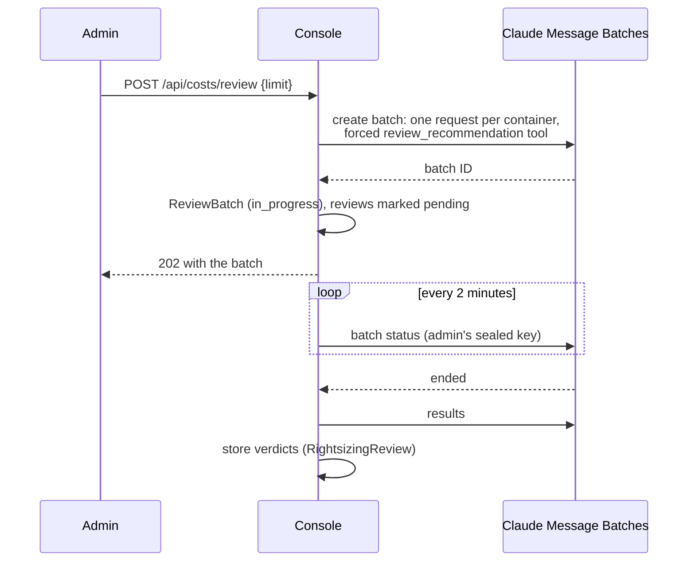

# Right-sizing batch review

Right-sizing recommendations follow a fixed policy (see [Cost model](cost-model.md#right-sizing-krr-policy)). The
policy cannot know that a JVM service sizes its heap from the container limit, or that a batch job's peaks fall
outside the window. The **batch review** asks Claude to check the most valuable recommendations for exactly those
risks, in bulk and at half price.

## What is sent

An admin clicks **Review with Claude** on the Costs page (`POST /api/costs/review`, default limit 50, at most 200).
The console picks candidates from the fleet's recommendations over the last 30 days:

1. skip low-confidence recommendations (fewer than 7 days of data);
2. keep those that need more (under-sized: OOM-killed, throttled or short of their request) or save $10 or more a
   month;
3. order shortfalls first, then by the size of the monthly change;
4. take the first `limit`.

If nothing qualifies, the request fails with `409` ("no recommendation is worth a review yet"). Only one batch can run
at a time (`409` while one is in progress). The admin needs a Claude key (`412` otherwise).

## How it runs

- Requests go through the **Message Batches API**, which costs half the normal price and returns within a day,
  usually within minutes.
- Each request sees **one** recommendation and must answer through a forced `review_recommendation` tool call.
- Requests are identified by a hash of the recommendation key (cluster, namespace, kind, name and container).
- The poller checks running batches every 2 minutes with the **submitting admin's** key, read sealed from the database
  each time.
- While a new review is pending, the previous verdict stays visible until the new one lands.
- Submitting a batch is audited (`rightsizing_review`).

## The verdict

The system prompt tells Claude the policy and Prophecy's specifics (JVM services such as metagraph, app, execution,
edweb, sparkedge and transpiler size the heap from the container limit or a fixed `-Xmx`; lowering memory without
lowering the heap causes OOM kills). It answers with:

| Verdict | Meaning |
|---|---|
| `safe` | The usage data supports the recommendation and nothing suggests a risk. |
| `adjust` | The direction is right but the numbers need changing; Claude gives the CPU request and memory request and limit it would use. |
| `risky` | Do not apply as is: for example a JVM heap tied to the limit, too little history, bursty batch work, OOM kills or heavy throttling. |

plus a brief reason. Verdicts are shown on each container's card on the Costs page, and the workload row shows the
worst verdict across its containers. Everyone can see verdicts; only admins can start a review.
