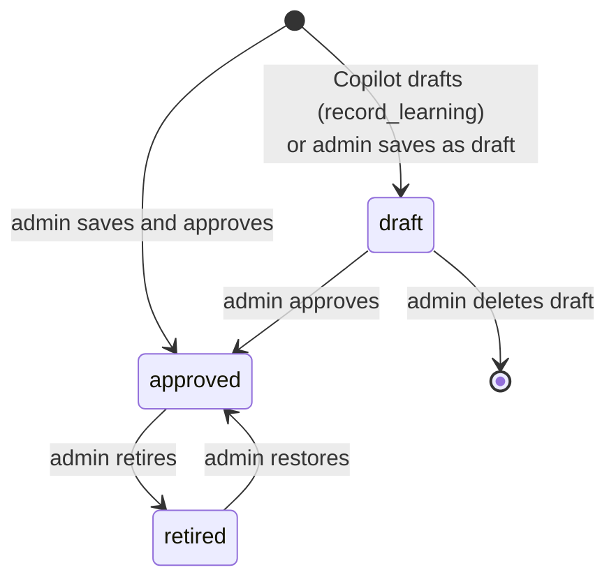
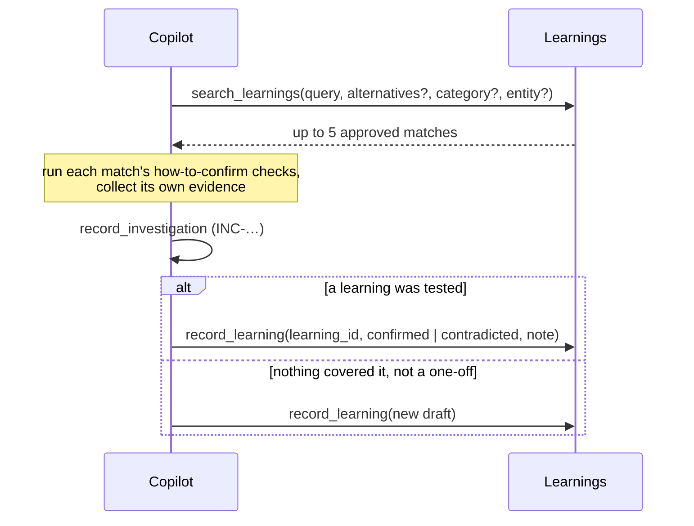

# Learnings

Learnings are the console's memory: reusable failure patterns distilled from investigations. Each one says what a
problem looks like, why it happens, how to prove it and how to fix it. The Copilot searches them early in every
investigation, and feeds each investigation's result back into them.

Together with the control-hub **knowledge graph** (the `.knowledgegraph/` notes shipped in the image and read with
`read_knowledge_node`), learnings give the Copilot two sources of prior knowledge:

| | Knowledge graph | Learnings |
|---|---|---|
| What | How control-hub works: flows, networking, Helm, cloud providers, gotchas | What went wrong before, and how it was proven |
| Written by | Engineers, in the control-hub repository | The Copilot (drafts) and admins |
| Changes | With a new image (`make kg` copies it in) | Live, in the console database |
| Linked by | — | A learning's `kgNodes` field names related nodes, e.g. `04-controlplane` |

## A learning

| Field | Meaning |
|---|---|
| `title` | The pattern in one line, e.g. "Metadata DB never created on Postgres 15+". |
| `category` | One of the investigation categories (`networking-dns`, `certificates`, `cloud-quota`, …). |
| `symptoms` | Exact error strings, failed steps, statuses and alert names: what the Copilot searches by. |
| `rootCause` | Why it happens. |
| `howToConfirm` | The specific checks (tool calls, queries) that prove it, so the next investigation runs them first. |
| `fix` | What to do. |
| `kgNodes` | Optional related knowledge-graph nodes, comma separated. |
| `entities`, `investigations` | Where it was seen (up to 50 of each). |
| `timesSeen`, `confirmed`, `contradicted` | How often it applied, and how investigations tested it. |
| `reviewNote` | Set when an investigation contradicted an approved learning. |
| `status` | `draft`, `approved` or `retired`. |

## Lifecycle

- **Only approved learnings are searchable.** Drafts come from the Copilot, which reads untrusted logs and pages that
  may hold planted text. An admin vets each draft before it can steer a later investigation.
- **Only drafts can be deleted.** An approved learning is retired instead, so the record of what the Copilot was told
  survives. Deleting a non-draft returns `409`.

## How the Copilot uses them

1. **Search.** As soon as the Copilot has a symptom (the failed step, an error string, a status or alert name) it
   calls `search_learnings` with the symptoms and, optionally, two to five `alternatives`: rewordings of the same
   problem as someone else might have written it (synonyms, the underlying cause, related error strings or component
   names). The prompt tells it a match is a hypothesis, not a conclusion: run its how-to-confirm checks and still
   collect its own evidence.
2. **Record.** After `record_investigation`, it calls `record_learning`. It cannot do so before: a learning must come
   from a recorded investigation.
    - `confirmed` adds a sighting (the investigation and entity) and increments `confirmed`.
    - `contradicted` increments `contradicted` and appends "INC-…: note" to `reviewNote`. The approved text is left
      alone; an admin decides what changes.
    - A **new draft** must have a title, symptoms and root cause, written as a general pattern (no customer names, IDs,
      hostnames, emails or secrets). Text is masked with the log-line redactor and clipped to 2,000 characters per
      field. A draft with the same title as an existing draft gains a sighting instead of a duplicate.

## Search ranking

`SearchLearnings` (`internal/store/learnings.go`) scores learnings in memory with **BM25** (k1 = 1.2, b = 0.75). The
set is small (hundreds), so there is no index. Field weights: title 3, symptoms 2, root cause 1, how-to-confirm 0.5,
fix 0.5, kg nodes 0.5. A matching category adds 1; an entity the learning was seen on adds 1.

When a search has rewordings (the Copilot's `alternatives`, or **Search by meaning** on the Learnings page),
`SearchLearningsAny` runs the BM25 search for each query and merges the rankings with **reciprocal rank fusion**
(k = 60; the original query counts double), so a learning written in other words than the question still surfaces.
The Copilot gets the top five approved matches.

Anthropic has no embeddings API, so "semantic" search on the Learnings page asks a small model (`claude-haiku-5-5`, with
the admin's Claude key) for three to five rewordings of the search (`GET /api/learnings/expand`), then searches for all
of them. Inside the Copilot this costs nothing extra: the model passes its own rewordings.

Tokenizing lowercases the text and splits on anything except letters, digits, `_` and `-`, so error codes, metric
names and resource names stay whole. Words shorter than three characters and common stopwords are dropped.

## From learning to log rule

An approved learning that keeps being confirmed is worth turning into a [log rule](log-rules.md), so the monitors
catch it without AI. The Learnings page marks learnings confirmed by three or more investigations "ready for a rule",
and **Draft log rule** asks Claude to draft one from the learning's symptoms.
