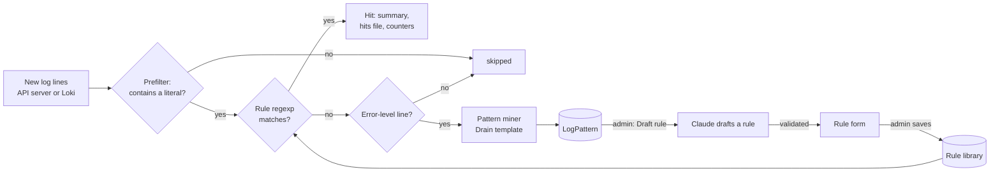

# Log rules and error patterns

The log parser is **rules, not AI**. It matches log lines against a library of known messages and never calls the
Claude API. The Copilot only explains what a hit means. Error lines that no rule knows are grouped into templates
(**error patterns**) so admins can turn the actionable ones into new rules.

## The rule library

Built-in rules ship embedded in the image from `internal/logrules/rules.yaml` (93 rules at the time of writing, mined
from the prophecy repository). Each rule has:

| Field | Meaning |
|---|---|
| `id` | kebab-case, unique and stable (findings reference it). |
| `title` | Short; shown on pills and in tables. |
| `services` | Pod-name prefixes without the `-prophecy` suffix (`metagraph` matches `metagraph-prophecy-7d9f…`). Empty = every pod. |
| `pattern` | Go RE2 regular expression, matched anywhere in the line; case-sensitive unless it starts with `(?i)`. |
| `severity` | `error`, `warning` or `info`. |
| `meaning`, `fix` | One sentence each. |
| `source` | `file:line` in the prophecy repository where the message is logged, or `""` for generic rules. |
| `examples` | At least one realistic full line that must match. |
| `not_examples` | Optional lines that must not match. |

The file also has `formats`: per-service regexps that pull the level word out of a line, so the parser can tell error
lines from others. The format reference is `internal/logrules/FORMAT.md`; see
[Adding a log rule](../development/adding-a-log-rule.md).

**Admin changes** are stored in the `LogRule` table, layered over the defaults:

- a custom rule is a row with a new ID;
- editing a built-in stores an override with the same ID (the UI marks it "Edited");
- disabling a built-in stores a row with `Enabled=false`;
- deleting a custom rule removes it; "Reset" on a built-in deletes the override and returns to the default.

Every saved rule is validated: the ID must be kebab-case, the severity valid, the pattern must compile as RE2, every
example must match and no not-example may match. Invalid rules are skipped when the library is compiled, so one bad
custom rule cannot disable the parser.

## Matching

A **prefilter** keeps scans cheap. For each rule the parser derives a small set of literal strings (at least four
characters) that every match must contain; a line is only tested against the regexp if it contains one of them. Most
log lines contain none, so the regexp rarely runs (about 16 ms per 3,000 lines). Rules with no usable literal always
run the regexp.

A rule only applies to pods whose name starts with one of its `services`.

## The background log parser

One background worker (`internal/parser`) is the only thing that parses cluster logs. Every `LOG_SCAN_INTERVAL`
(default 60 s) it scans every **tracked** cluster:

- Clusters are learned as users list them, so the worker needs no control-hub credentials of its own. The list is
  saved in `DATA_DIR/state/clusters.json` and restored after a restart.
- For clusters Grafana covers (a Loki mapping), it reads **Loki**: all non-system namespaces, pod logs only, and only
  lines containing one of the rules' literals. It stays 30 s behind Loki's ingestion, reads 10 minutes the first time
  and catches up at most 30 minutes after a gap.
- For other clusters it reads each container's log through the **API server**, in the namespaces in
  `LOG_SCAN_NAMESPACES` (default `prophecy`): 500 lines the first time a container is seen, then the lines written
  since the previous cycle. It also reads the crashed run of containers that restarted.
- Up to four clusters are scanned in parallel; a cluster still busy with the previous cycle is skipped.

Results:

- **Hits** are appended to `DATA_DIR/hits/<cluster>/<YYYY-MM-DD>.jsonl` (never rewritten; files older than
  `HIT_RETENTION_DAYS`, default 30, are deleted).
- A **per-cluster summary** (`DATA_DIR/state/<cluster>.json`) is what pages read. Counts cover the last 60 minutes; a
  rule not seen for 10 minutes is shown as resolved. Pods gone for a day are forgotten.
- `LogRuleHit` rows feed the "Hits 24 h" column and the parser monitor.

Pages read stored results only (`GET /api/clusters/{id}/log-scan`), and `pending` is true until the first cycle for a
cluster has finished. The pod logs page runs the parser over the lines it fetches (`parser` in the logs response), so
it can tag matching lines.

With monitors on, workloads logging error-level hits in the `prophecy` namespace become
[findings](monitors.md).

## Error patterns (the Drain miner)

Error-level lines that no rule matched are fed to the pattern miner (`internal/patterns`), a small version of the
**Drain** log-template algorithm:

1. **Is it an error?** The level word from the service's format, or error words and Java-style `…Exception` /
   `…Error` class names when there is no level.
2. **Mask and tokenize.**
    - JSON lines are reduced to their message: the values of `message`, `msg`, `error`, `err`, `exception` and
      `stack_trace`, in that order. The keys around them (time, caller, trace IDs) vary in order and value and would
      split one error into many templates. A JSON line with none of those keys is used as is.
    - Secrets and email addresses are masked.
    - Variable tokens (anything with a digit, long hex, UUIDs, emails, URLs, absolute paths) become `<*>`.
    - Generated pod and object names keep their stable part: `go-operator-sandbox-tdeemg` becomes
      `go-operator-sandbox-<*>`, `postgres-0` becomes `postgres-<*>`.
    - At most 40 tokens are compared.
3. **Group.** Lines with the same service, token count and first token are compared with existing templates; a line
   joins a template when at least 60% of positions agree (a `<*>` agrees with anything), and differing positions turn
   into `<*>`. There are at most 50 templates per group and 3,000 in all.
4. **Count** per cluster and per hour (48 hours of hourly counts are kept), so the UI can show "in 24 h", "in 6 h" and
   "new today".

Only Prophecy's namespaces are mined: every `prophecy*` namespace (such as `prophecy-execution` on execution planes) and
the namespaces in `LOG_SCAN_NAMESPACES`; a line with no namespace label is kept. Loki also returns logging, monitoring
and test workloads whose errors are not ours to triage. Services listed in `PATTERN_IGNORE_SERVICES` (default
`sla-tests,e2e-tests`) are skipped as well, because test runners log expected failures as ERROR. The service is the
pod name without its generated suffix (ReplicaSet hash and pod suffix, or StatefulSet ordinal). Because the Loki rule query only
returns lines matching rule literals, clusters read through Loki also get a capped sample of up to 500 error lines
every 30 minutes for the miner.

Templates are saved to the `LogPattern` table, so counts and IDs survive restarts. The grouping has a version (stored
as `log_patterns_version` in the `KV` table; currently 4). When a new image changes how lines are grouped, start-up
deletes the patterns still in **new** status, grouped the old way, rather than keep near-duplicates of the new ones;
ignored and ruled patterns are kept. Patterns nobody acted on are
dropped 14 days after they stop. An admin marks each pattern **ignored**, or **ruled** with the rule that now covers
it.

## Drafting rules with Claude

From a pattern (or an approved learning), an admin can ask Claude to draft a rule
(`POST /api/log-patterns/{id}/draft-rule`, `POST /api/learnings/{id}/draft-rule`). This is the only place the log
parser involves AI, and it is on demand.

1. The request uses the admin's Claude key and a forced `propose_log_rule` tool. The system prompt says: anchor on
   the stable text of the message, never on IDs, numbers, hosts, paths or timestamps; never a bare "ERROR" or
   "Exception" rule; say `applicable=false` when the message is not specific or actionable enough.
2. The console validates the draft: the pattern must compile as RE2, match every example **and the real line it came
   from**, match no not-example, and not be a bare "error".
3. If validation fails, Claude gets one retry with the failures.
4. The draft is returned to the UI. **Nothing is saved** until the admin reviews it in the rule form and saves it
   through `POST /api/log-rules`; saving a draft from a pattern marks the pattern `ruled`.
