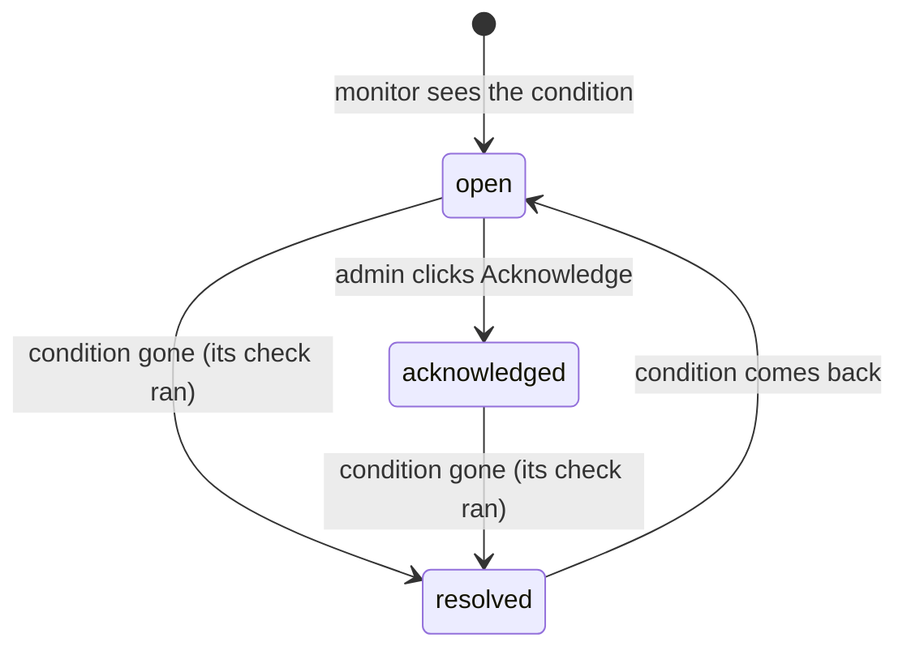

# Findings and monitors

A **finding** is a problem a scheduled monitor detected. Findings are what the Fleet overview calls "Needs attention",
what Slack is told about, and what the **Investigate** button hands to the Copilot.

Findings are different from **issues**. Issues come from the metrics parser and the log parser on each cluster, are
filtered by what each user can see, and live only while the rule keeps matching (see [Issues](../user-guide/issues.md)).
Findings come from the monitors, are stored in the `Finding` table with a lifecycle, and can be acknowledged.

## The monitors

The monitors run in-process every `MONITOR_INTERVAL` (default 5 minutes) when `MONITOR_ENABLED=true`. Each run has a
4-minute timeout. They read control-hub with `CONTROLHUB_SERVICE_TOKEN`, listing every realm in `REALMS` (default
`sap,dedicated-saas,public-saas`).

| Key | Name | Condition | Severity |
|---|---|---|---|
| `cp_failed` | Failed provisioning | Control plane in `CREATION_FAILED`, `DELETION_FAILED` or `UPDATE_FAILED` | critical |
| `cp_stuck` | Stuck provisioning | `CREATING`, `DELETING` or `UPDATING` for more than `STUCK_AFTER` (default 45m) | warning |
| `postdeploy_failed` | Post-deploy failed | Control plane or execution plane `postDeployStatus = failed` | warning |
| `ep_failed` | Execution plane failed | SAP execution plane in a `*_FAILED` status | critical |
| `log_errors` | Log parser | Error-severity log rule hits in the `prophecy` namespace of any cluster (recent lines) | warning; critical at 10 or more error-level matches |
| `cert_expiry` | Certificate expiry | The certificate served by an operational control plane expires in under `CERT_WARN_DAYS` (default 5) days | warning; critical at 1 day or less, or expired |

Notes:

- Execution planes are checked only when the `sap` realm could be listed.
- "Stuck" is measured from when the monitor first saw the control plane in that status (kept in the `KV` table, so it
  survives restarts).
- The certificate monitor connects to each operational control plane's host on port 443, eight at a time.
- The log parser monitor reads the log parser's stored summaries. It groups pods into workloads (it strips the
  ReplicaSet hash and pod suffix) so a finding follows the workload, not a pod name that changes on every restart.

The [Monitors](../user-guide/monitors.md) page lists these definitions, their interval and whether they notify Slack
("Console only" when `SLACK_WEBHOOK_URL` is empty or `SLACK_MUTE=true`).

## Lifecycle



Every run, the monitor reconciles what it observed with the stored findings:

1. **New condition.** A finding is created with a random `F-…` ID, `state = open` and `firstSeenAt = now`. Its `Key`
   is the kind plus the entity (for example `cp_failed:<control plane ID>`), so later runs update the same row.
2. **Still there.** The finding's title, detail, severity and `lastSeenAt` are refreshed. Its state is not changed, so
   an acknowledged finding stays acknowledged.
3. **Gone.** An open or acknowledged finding whose condition was not observed is **resolved** (`resolvedAt = now`),
   but only if its check actually ran this time. If a realm could not be listed, the execution plane list failed, a
   host could not be reached for the certificate check, or the log parser has no results for that cluster yet, the
   finding is left alone. A failing API never "resolves" a real problem.
4. **Back again.** A resolved finding whose condition returns is reopened: state `open`, a new `firstSeenAt`, and the
   investigation link and acknowledgement are cleared.

### Acknowledging

Admins can acknowledge an open finding from the Fleet overview. It records who acknowledged it (`acknowledgedBy`
email, `acknowledgedByName` control-hub username, `acknowledgedAt`) and writes an `acknowledge_finding` audit entry.
An acknowledged finding still counts as open in the fleet totals and still resolves on its own when the condition
clears. The UI shows "Acknowledged", or "Acknowledged by &lt;name&gt;" when someone else acknowledged it.

Findings acknowledged before the console recorded who did it are back-filled at start-up from the audit log.

### Linking investigations

When the Copilot records an investigation for an entity, every unresolved finding for the same entity ID gets that
investigation's ID. The finding then shows **View RCA**.

## Slack

A finding notifies Slack when it is **new** (created, or reopened after being resolved) and the monitors have already
**baselined**. The very first run after a fresh deploy records what is already broken without posting, so a new
install does not flood the channel. Slack is skipped when `SLACK_WEBHOOK_URL` is empty or `SLACK_MUTE=true`.

!!! tip "Dev environments"
    Set `SLACK_MUTE=true` on any environment that is not the team's real console, so test findings never reach the
    team channel.

## Investigate

**Investigate** (`POST /api/findings/{id}/investigate`) creates a chat titled "&lt;entity&gt; — &lt;title&gt;" and
returns a prompt of the form:

```text
The monitor flagged control plane <name> (id <id>, <realm>, <provider> <region>): <title> — <detail>
Investigate the root cause and tell me what to do.
```

The UI opens the chat and sends the prompt as the first message.
