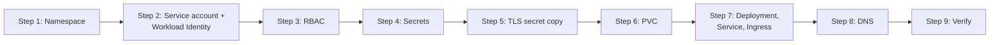

# Installing on Kubernetes

This page installs the console into its own namespace, `ai-console`, on the management cluster, the way the current
deployment runs. Replace every `<PLACEHOLDER>`. Never paste real secret values into files that are committed.

!!! note "The repository manifest is a starting point"
    `deploy/k8s/ai-console.yaml` has the ServiceAccount, a log-reading Role and RoleBinding, the Deployment, Service
    and Ingress. It does not create the namespace, the ClusterRole binding, the PVC or the volume mount, and its
    environment is a template. The steps below add those.



## 1. Create the namespace

```bash
kubectl create namespace ai-console
```

## 2. Service account and Workload Identity

The console reads GKE clusters and GCP Certificate Manager as control-hub's Google service account.

1. Create the Kubernetes service account with the Workload Identity annotation:

    ```yaml
    apiVersion: v1
    kind: ServiceAccount
    metadata:
      name: ai-console
      namespace: ai-console
      annotations:
        iam.gke.io/gcp-service-account: control-hub-admin@prophecy-cloud.iam.gserviceaccount.com
    ```

2. Let it impersonate the Google service account:

    ```bash
    gcloud iam service-accounts add-iam-policy-binding \
      control-hub-admin@prophecy-cloud.iam.gserviceaccount.com \
      --project prophecy-cloud \
      --role roles/iam.workloadIdentityUser \
      --member "serviceAccount:prophecy-cloud.svc.id.goog[ai-console/ai-console]"
    ```

## 3. RBAC

The console needs, in the cluster it runs in:

- `get`/`list` on pods and `get` on `pods/log` in control-hub's namespace, for `search_controlhub_logs`;
- `get`/`list` on `kubernetes.io/tls` secrets in `CERT_SECRET_NAMESPACES`, for the wildcard certificates.

The current deployment binds the service account to a ClusterRole named `ai-console-cluster-read` through a
ClusterRoleBinding of the same name:

```yaml
apiVersion: rbac.authorization.k8s.io/v1
kind: ClusterRole
metadata:
  name: ai-console-cluster-read
rules:
  - apiGroups: ["*"]
    resources: ["*"]
    verbs: ["get", "list", "watch"]
  - nonResourceURLs: ["*"]
    verbs: ["get"]
---
apiVersion: rbac.authorization.k8s.io/v1
kind: ClusterRoleBinding
metadata:
  name: ai-console-cluster-read
roleRef:
  apiGroup: rbac.authorization.k8s.io
  kind: ClusterRole
  name: ai-console-cluster-read
subjects:
  - kind: ServiceAccount
    name: ai-console
    namespace: ai-console
```

!!! warning "This role can read every Secret in the cluster"
    A read-everything ClusterRole includes Secrets in every namespace. If you only need what the code uses, replace it
    with a Role per namespace: pods and `pods/log` in control-hub's namespace (the repository manifest's
    `ai-console-read-logs` Role) and secrets in each `CERT_SECRET_NAMESPACES` namespace. Remember to set the
    RoleBinding's subject namespace: `kubectl apply -n` does not fill it in.

## 4. Secrets

Create `ai-console-secrets` in `ai-console`. The Deployment loads every key as an environment variable
(`envFrom`). Include only what you use; see the [configuration reference](../reference/configuration.md).

```bash
kubectl -n ai-console create secret generic ai-console-secrets \
  --from-literal=ENCRYPTION_KEY="$(openssl rand -base64 32)" \
  --from-literal=CONTROLHUB_SERVICE_TOKEN='<CONTROLHUB_ADMIN_TOKEN>' \
  --from-literal=CONTROLHUB_DEV_SERVICE_TOKEN='<CONTROLHUB_DEV_ADMIN_TOKEN>' \
  --from-literal=ATHENA_AUTH_TOKEN='<ATHENA_AUTH_TOKEN>' \
  --from-literal=AWS_PROD_ACCESS_KEY_ID='<AWS_KEY_ID>' \
  --from-literal=AWS_PROD_SECRET_ACCESS_KEY='<AWS_SECRET>' \
  --from-literal=AZURE_PROD_TENANT_ID='<AZURE_TENANT_ID>' \
  --from-literal=AZURE_PROD_CLIENT_ID='<AZURE_CLIENT_ID>' \
  --from-literal=AZURE_PROD_CLIENT_SECRET='<AZURE_CLIENT_SECRET>' \
  --from-literal=AZURE_PROD_SUBSCRIPTION_ID='<AZURE_SUBSCRIPTION_ID>' \
  --from-literal=GRAFANA_AWS_URL='https://<aws-grafana-host>' \
  --from-literal=GRAFANA_AWS_TOKEN='<GRAFANA_VIEWER_TOKEN>' \
  --from-literal=ANTHROPIC_API_KEY='<OPTIONAL_SHARED_KEY>' \
  --from-literal=SLACK_WEBHOOK_URL='<OPTIONAL_WEBHOOK>' \
  --from-literal=SLACK_BOT_TOKEN='<OPTIONAL_XOXB_TOKEN>' \
  --from-literal=SLACK_SIGNING_SECRET='<OPTIONAL_SIGNING_SECRET>'
```

!!! warning "Keep ENCRYPTION_KEY stable"
    Changing it makes every stored Claude key, session and Settings-added Grafana token unreadable. When you recreate
    the secret, reuse the existing value.

!!! tip
    Typing secrets on the command line leaves them in your shell history. Prefer `--from-env-file` with a file outside
    any repository that you delete afterwards.

## 5. Copy the TLS secret

The ingress serves the `*.app.prophecy.ai` wildcard. Copy the existing secret into `ai-console`:

```bash
kubectl -n <SOURCE_NAMESPACE> get secret wildcard-app-prophecy-ai-tls-secret -o json \
  | jq 'del(.metadata.namespace, .metadata.uid, .metadata.resourceVersion,
            .metadata.creationTimestamp, .metadata.ownerReferences, .metadata.managedFields)' \
  | kubectl -n ai-console apply -f -
```

!!! warning "The copy does not renew"
    The copy does not follow the original. Copy it again every time the wildcard is renewed. The console's own
    [Certificates](../user-guide/certificates.md) page shows when the wildcard expires.

## 6. Persistent volume claim

```yaml
apiVersion: v1
kind: PersistentVolumeClaim
metadata:
  name: ai-console-data
  namespace: ai-console
spec:
  accessModes: ["ReadWriteOnce"]
  storageClassName: standard-rwo
  resources:
    requests:
      storage: 10Gi
```

After it binds, set the PersistentVolume's reclaim policy to `Retain`, so deleting the claim never deletes the disk:

```bash
PV=$(kubectl -n ai-console get pvc ai-console-data -o jsonpath='{.spec.volumeName}')
kubectl patch pv "$PV" -p '{"spec":{"persistentVolumeReclaimPolicy":"Retain"}}'
```

(`standard-rwo` binds on first use, so the PV appears once the pod is scheduled.)

## 7. Deployment, Service and Ingress

Start from `deploy/k8s/ai-console.yaml`: replace `<TAG>`, `<NAMESPACE>` and `<AI_CONSOLE_HOST>`, then make these
changes to the Deployment.

**Environment.** Point it at control-hub and put the database and data on the volume. For a production control-hub,
`READ_ONLY=true` is required.

```yaml
env:
  - name: CONTROLHUB_URL
    value: http://control-hub.control-hub-prod.svc.cluster.local:8003
  - name: CONTROLHUB_LABEL
    value: control-hub-prod
  - name: READ_ONLY
    value: "true"
  - name: DATABASE_URL
    value: file:/data/ai-console.db
  - name: DATA_DIR
    value: /data
  - name: CONTROLHUB_LOGS_NAMESPACE
    value: control-hub-prod        # "" turns control-hub log search off
  - name: CONSOLE_ADMIN_EMAILS
    value: <admin1@example.com>,<admin2@example.com>
  - name: SLACK_MUTE
    value: "true"                  # false only on the team's real console
  - name: PUBLIC_URL
    value: https://<AI_CONSOLE_HOST>
envFrom:
  - secretRef:
      name: ai-console-secrets
```

**Volume.** Mount the PVC at `/data`, and set `fsGroup` so the non-root user can write to it:

```yaml
spec:
  template:
    spec:
      securityContext:
        runAsNonRoot: true
        runAsUser: 65532
        runAsGroup: 65532
        fsGroup: 65532
        seccompProfile:
          type: RuntimeDefault
      volumes:
        - name: data
          persistentVolumeClaim:
            claimName: ai-console-data
      containers:
        - name: ai-console
          imagePullPolicy: Always
          volumeMounts:
            - name: data
              mountPath: /data
```

**Resources.** The repository manifest requests `100m` CPU and limits memory to `512Mi`. The current deployment
runs with more headroom (requests: 1 CPU, 1Gi memory; limit: 2Gi memory), because the log parser, metric rules and cost
backfill all run in the same process.

Keep `replicas: 1` and `strategy: Recreate`: the monitors and workers run in-process and must not run twice, and a
ReadWriteOnce volume can only be mounted by one pod.

The Ingress annotations matter for the Copilot, whose replies stream over server-sent events for minutes:

```yaml
nginx.ingress.kubernetes.io/proxy-buffering: "off"
nginx.ingress.kubernetes.io/proxy-read-timeout: "900"
nginx.ingress.kubernetes.io/proxy-send-timeout: "900"
nginx.ingress.kubernetes.io/ssl-redirect: "true"
```

Apply:

```bash
kubectl -n ai-console apply -f ai-console.yaml
kubectl -n ai-console rollout status deploy/ai-console
```

## 8. DNS

Create an A record for `<AI_CONSOLE_HOST>` pointing at the ingress controller's external IP:

```bash
kubectl -n ai-console get ingress ai-console \
  -o jsonpath='{.status.loadBalancer.ingress[0].ip}'
```

For `controlhub.app.prophecy.ai` the record lives in the `prophecy.ai` Route53 zone.

## Optional: Copilot in Slack

Create the Slack app from `deploy/slack-app-manifest.yaml` and add its two secrets; see
[Slack app setup](slack.md).

## 9. Verify

1. The pod is ready (the readiness probe calls `GET /api/healthz`):

    ```bash
    kubectl -n ai-console get pods -l app=ai-console
    ```

2. The start-up log names the control-hub, model and read-only mode, and lists anything turned off:

    ```bash
    kubectl -n ai-console logs deploy/ai-console | head -30
    ```

    Expect `ai-console listening on :8090 (control-hub …, model …, read-only true)`. Lines such as
    `athena: ATHENA_AUTH_TOKEN not set; athena_read is off` or `control-hub log search is off` tell you what is
    disabled.

3. Open `https://<AI_CONSOLE_HOST>`, sign in, and check:
    - the header shows the control-hub label and, on a read-only deployment, the **Read-only** banner;
    - **Fleet overview → Last monitor run** shows a time within `MONITOR_INTERVAL`;
    - **Settings → Grafana** lists your instances with clusters and no errors;
    - **Clusters** loads with nodes and pods for a managed cluster;
    - a Copilot question gets an answer;
    - **Documentation** in the sidebar opens this manual at `/docs/`.
