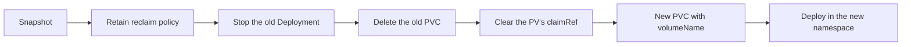

# Moving the data volume

A PersistentVolumeClaim belongs to one namespace. To move the console to another namespace (as was done when it moved
from `control-hub-dev` to `ai-console`) and keep its data, re-bind the same PersistentVolume to a new claim in the new
namespace. The disk itself never moves.



Throughout, `<OLD_NS>` is the current namespace and `<NEW_NS>` the target.

## 1. Snapshot first

Take a consistent snapshot ([Backups](backups.md#take-a-snapshot)). If anything goes wrong you can restore from it.

## 2. Keep the disk when the claim is deleted

```bash
PV=$(kubectl -n <OLD_NS> get pvc ai-console-data -o jsonpath='{.spec.volumeName}')
echo "$PV"
kubectl patch pv "$PV" -p '{"spec":{"persistentVolumeReclaimPolicy":"Retain"}}'
kubectl get pv "$PV" -o jsonpath='{.spec.persistentVolumeReclaimPolicy}{"\n"}'   # Retain
```

!!! danger
    Do not continue until the policy reads `Retain`. With `Delete`, deleting the claim deletes the disk.

Note the PV's storage class, size and access mode for step 5:

```bash
kubectl get pv "$PV" -o jsonpath='{.spec.storageClassName} {.spec.capacity.storage} {.spec.accessModes}{"\n"}'
```

## 3. Stop the old deployment

```bash
kubectl -n <OLD_NS> scale deploy/ai-console --replicas=0
kubectl -n <OLD_NS> wait --for=delete pod -l app=ai-console --timeout=120s
```

## 4. Release the volume

Delete the old claim, then clear the PV's `claimRef` so it becomes `Available`:

```bash
kubectl -n <OLD_NS> delete pvc ai-console-data
kubectl get pv "$PV" -o jsonpath='{.status.phase}{"\n"}'          # Released
kubectl patch pv "$PV" --type json -p '[{"op":"remove","path":"/spec/claimRef"}]'
kubectl get pv "$PV" -o jsonpath='{.status.phase}{"\n"}'          # Available
```

## 5. Create the claim in the new namespace

Bind the claim to this exact volume with `volumeName`. Storage class, size and access mode must match the PV.

```yaml
apiVersion: v1
kind: PersistentVolumeClaim
metadata:
  name: ai-console-data
  namespace: <NEW_NS>
spec:
  accessModes: ["ReadWriteOnce"]
  storageClassName: standard-rwo
  volumeName: <PV>
  resources:
    requests:
      storage: 10Gi
```

```bash
kubectl apply -f pvc.yaml
kubectl -n <NEW_NS> get pvc ai-console-data      # STATUS Bound, VOLUME <PV>
```

## 6. Deploy in the new namespace

Follow [Installing on Kubernetes](install.md) for the new namespace: service account (and its Workload Identity
binding for `<NEW_NS>/ai-console`), RBAC subjects, `ai-console-secrets` **with the same `ENCRYPTION_KEY`**, the TLS
secret copy, the Deployment, Service and Ingress. Then:

```bash
kubectl -n <NEW_NS> rollout status deploy/ai-console
kubectl -n <NEW_NS> logs deploy/ai-console | head -30
```

Sign in and check that your chats, investigations and learnings are still there.

## 7. Clean up the old namespace

Once the new deployment works, delete the old Deployment, Service, Ingress, secrets and service account, and remove
the old namespace's service account from the ClusterRoleBinding subjects and the Workload Identity policy.

## Use an existing disk

To bind a disk that has no PersistentVolume yet (for example one restored from a snapshot), create the PV by hand:

```yaml
apiVersion: v1
kind: PersistentVolume
metadata:
  name: ai-console-data-restored
spec:
  capacity:
    storage: 10Gi
  accessModes: ["ReadWriteOnce"]
  persistentVolumeReclaimPolicy: Retain
  storageClassName: standard-rwo
  csi:
    driver: pd.csi.storage.gke.io
    volumeHandle: projects/<PROJECT>/zones/<ZONE>/disks/<DISK>
    fsType: ext4
```

Then create the claim as in step 5 with `volumeName: ai-console-data-restored`.
